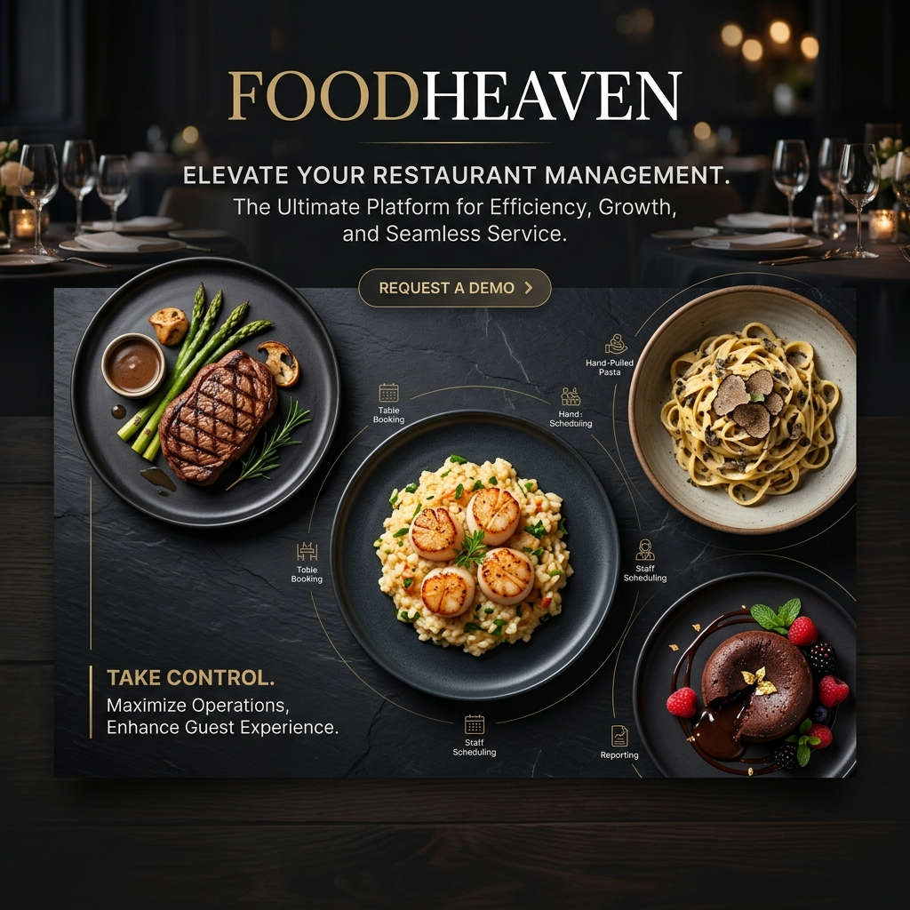
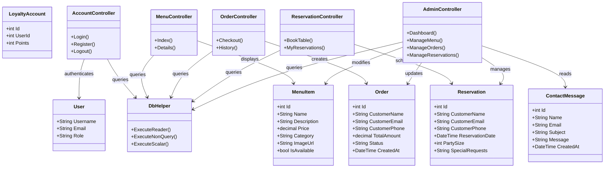

# FoodHeaven 🍽️

[](https://learn.microsoft.com/en-us/dotnet/csharp/)
[](https://dotnet.microsoft.com/)
[](https://tailwindcss.com/)
[](#)

Experience Culinary Excellence. A premium, full-stack restaurant management system built with ASP.NET Core MVC and Tailwind CSS.

---

<p align="center">
  
</p>

---

## 🗺️ Navigation Index

1. [📖 Overview](#-overview)
2. [✨ Key Features](#-key-features)
3. [🏗️ Application Architecture](#%EF%B8%8F-application-architecture)
4. [🚀 Tech Stack](#-tech-stack)
5. [🛠️ Getting Started](#%EF%B8%8F-getting-started)
6. [🔐 Admin Access](#-admin-access)
7. [🕒 Business Logic Details](#-business-logic-details)
8. [🤝 Contributing](#-contributing)

---

## 📖 Overview

**FoodHeaven** is a modern, responsive web application designed for high-end restaurants. It bridges the gap between customer engagement and restaurant operations, offering a stunning public-facing interface for diners and a powerful, mobile-responsive dashboard for administrators.

Whether you are booking a table for a romantic dinner, ordering your favorite meal online, or managing the day-to-day operations of a busy kitchen, FoodHeaven makes it seamless.

---

## ✨ Key Features

### 🌍 Public Interface (Customer)
- **Stunning UI/UX:** Built with a "dark mode first" premium aesthetic, featuring smooth parallax scroll, glassmorphism, and micro-animations.
- **Dynamic Menu:** Browse items by category (Starters, Mains, Desserts, Drinks) with instant search and filtering.
- **Online Ordering:** Full shopping cart functionality with persistent local storage and order history tracking.
- **Table Reservations:** Real-time table booking system with party size and special requests.
- **Live Status:** Footer "Working Hours" indicator that dynamically updates (Open/Closed) based on the time of day.
- **Responsive Design:** Flawless experience on mobile, tablet, and desktop.

### 🛡️ Admin Dashboard (Staff)
- **Mobile-First Control:** A fully responsive sidebar and grid layout that works perfectly on iPads and phones for staff on the move.
- **Menu Management:** Add, edit, or remove dishes, adjust prices, and update availability in real-time.
- **Order Command Center:** View incoming orders, update status (Pending -> Preparing -> Completed), and track revenue.
- **Reservation Book:** Manage upcoming bookings and optimize table turnover.
- **User Management:** View registered users and manage admin staff access.
- **Analytics:** Daily revenue reports, order counts, and historical data visualization.
- **Message Center:** Read and respond to customer inquiries from the contact form.

---

## 🏗️ Application Architecture

The system utilizes an **ASP.NET Core MVC** architectural pattern with a decoupled data access layer via raw SQL commands and a custom helper to optimize performance.



---

## 🚀 Tech Stack

- **Framework:** [.NET 8 (ASP.NET Core MVC)](https://dotnet.microsoft.com/)
- **Database:** Entity Framework Core with SQL Server (and direct `DbHelper` raw SQL execution)
- **Styling:** [Tailwind CSS](https://tailwindcss.com/) (CDN & Configured) + Custom CSS Variables
- **Frontend Logic:** Vanilla JavaScript (Zero-dependency, fast & lightweight)
- **Icons:** Google Material Symbols
- **Security:** BCrypt Password Hashing, Role-Based Authorization

---

## 🛠️ Getting Started

### Prerequisites
- [.NET 8.0 SDK](https://dotnet.microsoft.com/download)
- SQL Server (LocalDB or Express)

### Installation

1. **Clone the repository:**
   ```bash
   git clone https://github.com/asad594/Food-Heaven-.git
   cd Food-Heaven-
   ```
2. **Configure Database:** Update the connection string in `appsettings.json` if necessary:
   ```json
   "ConnectionStrings": {
     "DefaultConnection": "Server=(localdb)\\mssqllocaldb;Database=FoodHeavenDB;Trusted_Connection=True;MultipleActiveResultSets=true"
   }
   ```
3. **Run Migrations / Setup Database Schema:**
   ```bash
   dotnet ef database update
   ```
4. **Start the Application:**
   ```bash
   dotnet run
   ```
   Visit `http://localhost:5000` or the ports specified in your console in your browser.

---

## 🔐 Admin Access

The system automatically seeds default admin accounts on the first run.

| Role | Username | Password |
|:---|:---|:---|
| **Super Admin** | `admin` | `admin@123` |

> [!NOTE]
> For security, please change these credentials after your first login via the Admin Dashboard.

---

## 🕒 Business Logic Details

The application features smart schedule logic for the "Open Now" indicator:
- **Monday - Friday:** 11:00 AM – 02:00 AM (Next Day)
- **Saturday - Sunday:** 11:00 AM – 04:00 AM (Next Day)

---

## 🤝 Contributing

Contributions are welcome! Please feel free to submit a Pull Request.

1. Fork the Project
2. Create your Feature Branch (`git checkout -b feature/AmazingFeature`)
3. Commit your Changes (`git commit -m 'Add some AmazingFeature'`)
4. Push to the Branch (`git push origin feature/AmazingFeature`)
5. Open a Pull Request
