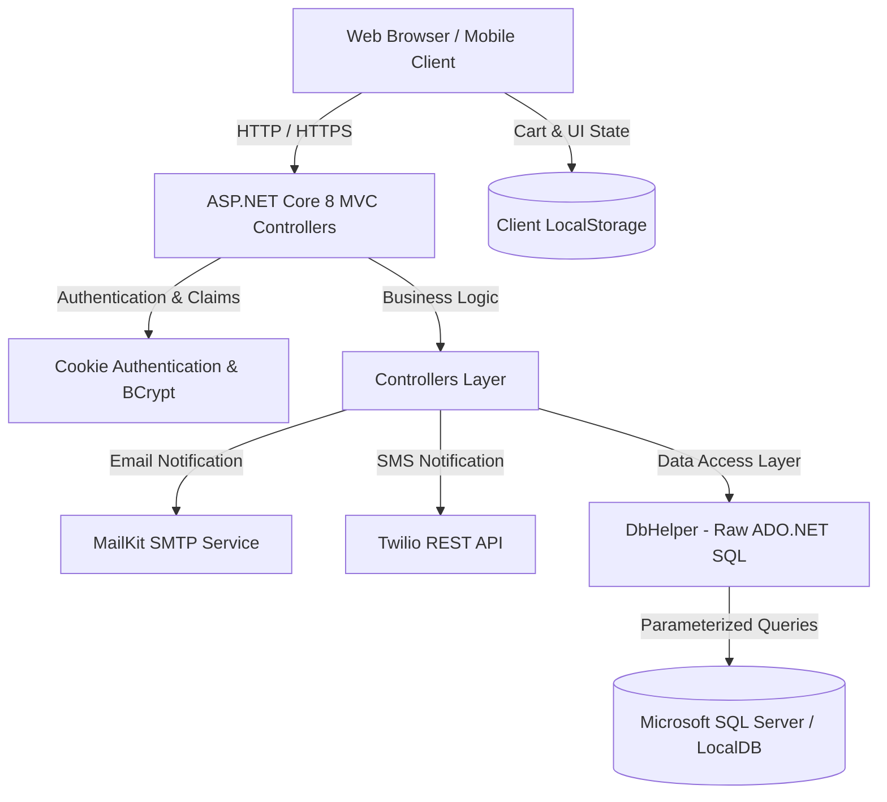
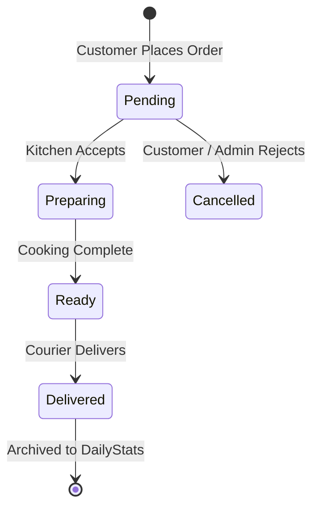
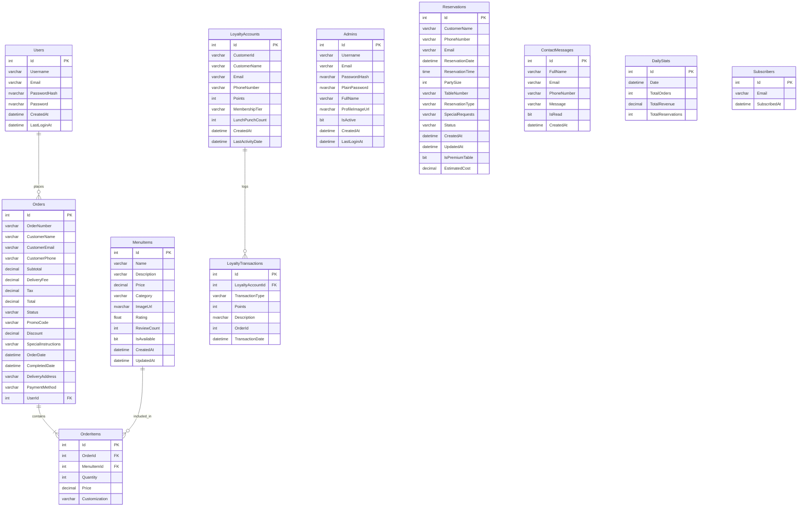

# Product Requirements Document (PRD)

**Project Name:** FoodHeaven Restaurant Management & Online Ordering System  
**Document Version:** 1.0.0  
**Status:** Approved / Active Baseline  
**Target Platform:** Web (Desktop, Tablet, Mobile Responsive)  
**Framework Version:** ASP.NET Core 8.0 MVC  
**Last Updated:** October 2026  

---

## 1. Executive Summary & Vision

### 1.1 Executive Summary
**FoodHeaven** is an enterprise-grade, full-stack restaurant management and customer ordering web application built using ASP.NET Core 8.0 MVC, direct high-performance ADO.NET SQL data access, Tailwind CSS, and Vanilla JavaScript. FoodHeaven bridges the gap between digital diner engagement and physical restaurant operations by providing:
1. A public-facing web portal for browsing menus, customizable cart management, online ordering, live table booking with party and tier options, and customer loyalty rewards.
2. A staff-facing Admin Command Center enabling live kitchen order tracking, menu catalog CRUD, reservation scheduling, customer support messaging, staff credential administration, and end-of-day revenue archiving.

### 1.2 Product Vision
To deliver a culinary web application that combines the aesthetics of a high-end Michelin-starred restaurant with the operational efficiency of modern cloud-ready restaurant management software.

### 1.3 Key Objectives
- **Zero-Latency Ordering:** Local client-side cart synchronization eliminates server overhead during menu browsing.
- **Unified Operational Control:** Single responsive dashboard for managing dining room bookings, kitchen order flows, menu availability, and diner feedback.
- **Automated Communication:** Instant customer notifications via transactional SMTP emails and Twilio SMS.
- **Enterprise Security:** BCrypt password hashing, anti-forgery token verification, parameterized SQL execution against injection, and role-based claim authentication.

---

## 2. User Personas & Roles

### 2.1 User Roles Matrix

| Role | Access Level | Description | Default Landing Page |
|---|---|---|---|
| **Guest Diner** | Anonymous Public | Can browse menu, add to cart, check table availability, submit contact forms, and subscribe to newsletters. | `/` (Home) |
| **Registered Customer** | Authenticated User | Can place online orders, view active and historical orders, book standard/premium tables, view saved reservation history, and participate in loyalty punch cards. | `/Menu` or `/Order/MyOrders` |
| **Administrator** | Authenticated Staff / Manager | Has full administrative control over orders, menu catalog, tables, inquiries, customer accounts, staff credentials, and financial archives. | `/Admin/Dashboard` |

### 2.2 User Personas

#### Persona 1: Diners & Customers (Evelyn)
- **Goal:** Quickly explore food choices, filter by dietary requirements (e.g., Healthy, Desi, Starters), book an anniversary dinner table, and apply promo discount codes at checkout.
- **Pain Points:** Slow multi-step checkouts, clunky mobile interfaces, lack of confirmation regarding booking status.

#### Persona 2: Restaurant Manager & Kitchen Operator (Marco)
- **Goal:** Real-time visibility into incoming orders, updating preparation states (Pending $\rightarrow$ Preparing $\rightarrow$ Ready $\rightarrow$ Delivered), overseeing table capacities, and managing daily revenue totals.
- **Pain Points:** Desktop-only dashboards that cannot be operated from an iPad or smartphone on the restaurant floor.

---

## 3. System Architecture & Tech Stack

### 3.1 Architectural Overview
The application follows the classic **Model-View-Controller (MVC)** architectural pattern, decoupled into discrete layers:



### 3.2 Technology Stack

| Layer | Technology | Rationale / Details |
|---|---|---|
| **Target Runtime** | .NET 8.0 (`net8.0`) | Long-Term Support (LTS) release with top-tier performance. |
| **Backend Framework** | ASP.NET Core MVC 8.0 | Robust server-side MVC framework with built-in dependency injection. |
| **Data Access Layer** | ADO.NET (`Microsoft.Data.SqlClient` v5.2.1) via `DbHelper` | High-throughput, raw SQL execution with zero ORM overhead and explicit T-SQL query control. |
| **Database Engine** | Microsoft SQL Server (LocalDB, Express, or Azure SQL) | Relational database utilizing identity increments, foreign keys, and T-SQL features (e.g. `OUTPUT INSERTED.Id`). |
| **Frontend Styling** | Tailwind CSS (CDN with JIT) + Custom CSS Variables | Responsive, utility-first design system featuring custom dark/light color tokens. |
| **Icons & Typography** | Google Material Symbols Outlined, Plus Jakarta Sans, Noto Sans | Modern typography tailored for high-end dining aesthetics. |
| **Client-Side Scripting** | Vanilla JavaScript (ES6+ Class-based) | Zero dependency runtime for shopping cart, modal interactions, and AJAX communications. |
| **Authentication** | ASP.NET Core Cookie Authentication | Persistent sliding expiration cookies (8-hour window). |
| **Password Security** | BCrypt.Net-Next (v4.0.3) | Salted, adaptive cryptographic password hashing. |
| **Email Service** | MailKit (v4.15.1) + MimeKit | Robust SMTP email delivery via Gmail/custom SMTP. |
| **SMS Service** | Twilio REST SDK (v7.14.1) | Automated SMS dispatch for reservation confirmation with graceful fallback simulation. |

---

## 4. Functional Requirements

### 4.1 Module 1: Authentication & Account Management

#### 4.1.1 Unified Login System (`/Account/Login`)
- Single unified login interface supporting both staff (`Admin`) and diners (`User`).
- **Processing Logic:**
  1. Authenticates against the `Admins` table first (`IsActive = 1`). If valid BCrypt verification succeeds, records `LastLoginAt = NOW()`, creates claims with role `"Admin"` and `"FullName"`, and redirects to `/Admin/Dashboard`.
  2. If admin match fails, authenticates against the `Users` table by username or email. If verified, updates `LastLoginAt`, creates claims with role `"User"`, and redirects to `/Menu`.
  3. If both fail, displays `TempData["ErrorMessage"] = "Invalid username or password"`.
- Supports direct Admin Login endpoint via `/Account/AdminLogin`.

#### 4.1.2 Customer Registration (`/Account/Register`)
- Fields required: `username`, `email`, `password`.
- Validates email uniqueness in `Users` table.
- Stores BCrypt salted password hash in `PasswordHash`.
- On success, sets `TempData["SuccessMessage"]` and routes to `/Account/Login`.

#### 4.1.3 Session & Cookie Management
- Session timeout configured to 30 minutes with `HttpOnly` and `IsEssential` security flags.
- Cookie authentication set with 8-hour persistent sliding expiration.
- Complete session invalidation and claims clearance on `/Account/Logout`.

---

### 4.2 Module 2: Menu Catalog & Exploration

#### 4.2.1 Menu Catalog Listing (`/Menu`)
- Retrieves all menu items where `IsAvailable = 1`.
- Dynamic category filtering supporting standard categories:
  - `Starters`
  - `Mains`
  - `Desi`
  - `Desserts`
  - `Drinks`
  - `Healthy`
- Real-time search query support (`?search=...`) using parameterized SQL `LIKE` queries against `Name` and `Description`.
- Each menu card displays:
  - Dish Name, Category, Price, and Description.
  - High-resolution imagery (local `/images/` or CDN).
  - Star rating badge (0.0 to 5.0) and review count.
  - Interactive "Add to Cart" and "Order Now" quick-action buttons.

#### 4.2.2 Menu Item Details (`/Menu/Details/{id}`)
- Full detail view presenting expanded dish descriptions, pricing, allergen/customization notes, rating breakdown, and add-to-cart controls.

#### 4.2.3 Menu AJAX APIs
- `GET /Menu/GetMenuItems?category={category}`: Returns JSON payload of items filtered by category.
- `GET /Menu/GetMenuItem?id={id}`: Returns JSON payload of a single item for admin modal editing.

---

### 4.3 Module 3: Cart Management & Promo Code Engine

#### 4.3.1 LocalStorage Shopping Cart (`wwwroot/js/app.js`)
- Client-side persistence using key `foodHeaven_cart`.
- Integrity validation: Automatically filters out malformed or negative-indexed items on initialization.
- Functions implemented in `ShoppingCart` class:
  - `addItem(item, silent)`: Appends new item or increments quantity of existing item. Displays toast notification.
  - `removeItem(itemId)`: Removes item from cart and recalculates totals.
  - `updateQuantity(itemId, quantity)`: Updates count; auto-removes item if quantity drops to 0.
  - `setDirectCheckout(item)` / `getCheckoutItems()`: Supports immediate "Order Now" bypass without disrupting persistent cart contents.
  - `clearCart()`: Cleans cart upon successful checkout.

#### 4.3.2 Promo Code Discount Engine (`/Order/ApplyPromoCode`)
- Evaluates promotional vouchers dynamically via server endpoint:
  - `SAVE10` $\rightarrow$ 10% discount on order subtotal.
  - `SAVE20` $\rightarrow$ 20% discount on order subtotal.
  - `FIRST15` $\rightarrow$ 15% discount on order subtotal.
- Returns `{ success: true, discount: decimal, message: string }`.

---

### 4.4 Module 4: Order Placement & Order Lifecycle

#### 4.4.1 Checkout Process (`/Order/Checkout`)
- Collects customer delivery details:
  - Customer Name, Email, Phone Number.
  - Delivery Address and Optional Special Instructions.
  - Payment Method (Cash on Delivery, Credit/Debit Card, Online Banking).
- Calculates comprehensive bill breakdown:
  - `Subtotal`: Sum of item prices $\times$ quantities.
  - `DeliveryFee`: Standard flat or calculated fee.
  - `Tax`: Applicable tax calculations.
  - `Discount`: Verified promo voucher reductions.
  - `Total`: `Subtotal + DeliveryFee + Tax - Discount`.

#### 4.4.2 Order Submission (`POST /Order/Create`)
- Validates item existence in `MenuItems` table to prevent price tampering or orphaned items.
- Generates unique tracking identifier: `ORD-YYYYMMDD-XXXX` (random 4-digit token).
- Associates `UserId` if order placed by authenticated customer.
- Inserts order record into `Orders` table using T-SQL `OUTPUT INSERTED.Id`.
- Inserts each child record into `OrderItems` table with captured price, quantity, and customization notes.
- Returns `{ success: true, orderNumber: string, orderId: int }`.

#### 4.4.3 Order Confirmation & History (`/Order/Confirmation/{id}`, `/Order/MyOrders`)
- Confirmation page displays invoice summary, items purchased, customer details, and live status.
- `/Order/MyOrders` lists all past orders placed by the logged-in user, grouped with item thumbnails and statuses. Also displays past reservations booked under that user's email/name.

#### 4.4.4 Order Status Lifecycle


---

### 4.5 Module 5: Table Reservation System

#### 4.5.1 Booking Workflow (`/Reservation/Create`)
- Field inputs:
  - Guest Name, Phone Number, Email Address.
  - Reservation Date and Time Slot (`TimeSpan`).
  - Party Size (integer range: 1 to 20 guests).
  - Table Number / Zone.
  - Special Requests (e.g., anniversary, dietary requirements, high chair).
- **Reservation Tiers & Pricing Logic:**
  - `Standard`: Complimentary table booking (`EstimatedCost = $0.00`, `IsPremiumTable = false`).
  - `Premium`: VIP table booking with dedicated service. Automatically calculates cost: $\text{PartySize} \times \$15.00$ (`EstimatedCost`, `IsPremiumTable = true`).
  - `PrivateParty`: Banquet / private dining room arrangement (`EstimatedCost = $0.00`, `IsPremiumTable = false`).

#### 4.5.2 Real-time Availability Verification (`/Reservation/CheckAvailability`)
- Endpoint accepts `date`, `time`, and `tableNumber`.
- Queries `Reservations` table for existing bookings where `Status = 'Confirmed'` on the given date, time, and table.
- Returns `{ available: boolean }`.

#### 4.5.3 Automated Notifications
- **Email Confirmation:** Delivered using `EmailService` (MailKit SMTP). Sends responsive HTML email displaying guest details, date, time, table type, and estimated cost.
- **SMS Confirmation:** Dispatched via Twilio REST API to the guest's mobile number. Operates with silent failure/simulation logging so third-party SMS failures never disrupt the user's booking workflow.

#### 4.5.4 Reservation Cancellation & Confirmation
- Customer confirmation screen at `/Reservation/Confirmation/{id}`.
- Cancellation endpoint `POST /Reservation/Cancel` updates status to `"Cancelled"` and records timestamp in `UpdatedAt`.

---

### 4.6 Module 6: Customer Loyalty & Rewards Program

#### 4.6.1 Loyalty Dashboard (`/Loyalty` or `/Loyalty/Index/{customerId}`)
- Customer profile with membership tiering:
  - **Bronze:** 0 – 499 points.
  - **Silver:** 500 – 999 points.
  - **Gold:** 1,000 – 1,999 points.
  - **Platinum:** 2,000+ points.
- Digital lunch punch card tracker (`LunchPunchCount`).
- Displays 10 most recent transactions from `LoyaltyTransactions` (Earn, Redeem, Expire).
- Auto-generates a demo account with 1,250 points (Gold tier) if no account exists for seamless preview.

#### 4.6.2 Earning & Redeeming Points
- `POST /Loyalty/AddPoints`: Increments points balance, upgrades membership tier automatically based on new thresholds, and writes an `"Earn"` entry to `LoyaltyTransactions`.
- `POST /Loyalty/RedeemReward`: Validates sufficient points balance, deducts points from `LoyaltyAccounts`, updates `LastActivityDate`, and logs a `"Redeem"` transaction entry with negative points.
- `GET /Loyalty/GetHistory`: Returns JSON array of transaction history for a customer account.

---

### 4.7 Module 7: Contact Center & Newsletter

#### 4.7.1 Contact Us (`/Contact`)
- Inquiries collect: Full Name, Email Address, Phone Number, and Message.
- Supports standard MVC form submission (`POST /Contact/Submit`) and AJAX submission (`POST /Contact/SubmitAjax`).
- Inquiries are logged into `ContactMessages` with `IsRead = 0` for admin processing.

#### 4.7.2 Newsletter Subscription (`POST /Home/Subscribe`)
- Accepts customer email address.
- Validates email formatting; checks for existing subscription in `Subscribers` table.
- Inserts new subscriber record with timestamp `SubscribedAt`.

#### 4.7.3 Real-Time Business Hours Indicator
- Dynamically rendered in global footer based on local operational hours:
  - **Monday – Friday:** 11:00 AM – 02:00 AM (Next Day).
  - **Saturday – Sunday:** 11:00 AM – 04:00 AM (Next Day).
  - Displays dynamic `"Open Now"` (green badge) or `"Closed"` (amber badge).

---

### 4.8 Module 8: Admin Command Center

All administrative views and management endpoints require `[Authorize(Roles = "Admin")]`.

#### 4.8.1 Key Performance Metrics Dashboard (`/Admin/Dashboard`)
The management console aggregates live statistics:
- **Total Revenue:** Sum of completed order totals + completed premium reservation revenues.
- **Premium Reservation Revenue:** Sum of `EstimatedCost` from completed reservations.
- **Orders Count & Pending Count:** Total orders received vs. orders requiring immediate kitchen action.
- **Reservations Today & Total:** Count of bookings scheduled for today's date vs. all-time total.
- **Unread Inquiries:** Count of incoming contact messages where `IsRead = 0`.
- **User & Admin Totals:** Registered diners vs. active staff administrators.
- **Real-Time Feed Lists:** Recent 5 orders, recent 5 contact messages, and recent 5 registered users.

#### 4.8.2 Menu Catalog Management
- **Add Menu Item (`POST /Admin/AddMenuItem`):** Form modal collecting name, description, price, category, image URL, rating, and review count. Inserts into database and returns created object.
- **Update Menu Item (`POST /Admin/UpdateMenuItem`):** Edits pricing, availability toggle (`IsAvailable`), image URL, category, or descriptions. Records `UpdatedAt = NOW()`.
- **Delete Menu Item (`POST /Admin/DeleteMenuItem`):** Permanently removes menu item by ID.

#### 4.8.3 Order Management Desk
- **Live Orders Fetch (`GET /Admin/GetOrders?status={status}`):** Retrieves 50 most recent orders grouped with their child `OrderItems` and dish names.
- **Status Transition (`POST /Admin/UpdateOrderStatus` / `/Order/UpdateStatus`):** Updates order state (`Pending`, `Preparing`, `Ready`, `Delivered`, `Cancelled`). When marked `Delivered` or `Completed`, automatically writes `CompletedDate = NOW()`.

#### 4.8.4 Table Reservation Desk (`/Admin/Reservations`)
- Dedicated reservation schedule view sorting bookings by date and time slot.
- Real-time status update (`POST /Admin/UpdateReservationStatus`).
- Reservation record cleanup (`POST /Admin/CleanReservation`).

#### 4.8.5 Customer & Staff User Administration
- **Staff Listing & Creation (`GET /Admin/GetAdminsData`, `POST /Admin/AddAdmin`):** Displays administrative accounts; allows creating new administrators with username, email, full name, and BCrypt-hashed password.
- **Customer User Listing (`GET /Admin/GetUsersData`):** Displays registered customer accounts, registration dates, and last login timestamps.
- **Password Reset (`POST /Admin/ResetUserPassword`):** Resets a forgotten customer password to default (`123456`) with updated BCrypt hash.

#### 4.8.6 Message Center
- `GET /Admin/GetMessages?unreadOnly={true|false}`: Fetches customer contact submissions.
- `POST /Admin/MarkMessageRead`: Marks message as read (`IsRead = 1`).
- `POST /Admin/ClearAllMessages`: Bulk deletes inquiry inbox.

---

### 4.9 Module 9: End-of-Day Financial Archival System

To keep daily operational tables performant while preserving historical audit trails:
- **Clear All Orders (`POST /Admin/ClearAllOrders`):** Aggregates today's total order count and un-cancelled revenue, upserts the figures into `DailyStats` for the current date, and then truncates/deletes active rows from `OrderItems` and `Orders`.
- **Clear All Reservations (`POST /Admin/ClearAllReservations`):** Aggregates today's completed/active reservation count and premium revenue, merges the metrics into `DailyStats`, and purges active rows from `Reservations`.
- **Historical Data Reporting (`GET /Admin/GetHistoryData`):** Returns historical daily records from `DailyStats` showing `Date`, `TotalOrders`, `TotalRevenue`, and `TotalReservations`.
- **Purge History (`POST /Admin/ClearAllHistory`):** Clears the `DailyStats` ledger when explicitly requested.

---

## 5. Database Schema & Data Models

The database schema comprises **10 primary relational tables** managed in Microsoft SQL Server (`FoodHeavenDb`).



### 5.1 Tables Specification

#### 1. `Admins` Table
| Column | Data Type | Nullable | Default | Description |
|---|---|---|---|---|
| `Id` | `INT IDENTITY(1,1)` | No | PK | Unique identifier |
| `Username` | `VARCHAR(50)` | No | - | Staff login handle |
| `Email` | `VARCHAR(255)` | No | - | Staff email address |
| `PasswordHash` | `NVARCHAR(MAX)` | No | - | Salted BCrypt password hash |
| `PlainPassword`| `NVARCHAR(MAX)` | Yes | NULL | Plain password storage for administrative view |
| `FullName` | `VARCHAR(100)` | No | - | Staff display name |
| `ProfileImageUrl` | `NVARCHAR(MAX)` | Yes | NULL | Avatar URL |
| `IsActive` | `BIT` | No | 1 | Account activation status flag |
| `CreatedAt` | `DATETIME` | No | `GETDATE()` | Registration timestamp |
| `LastLoginAt` | `DATETIME` | Yes | NULL | Timestamp of most recent login |

#### 2. `Users` Table
| Column | Data Type | Nullable | Default | Description |
|---|---|---|---|---|
| `Id` | `INT IDENTITY(1,1)` | No | PK | Customer account identifier |
| `Username` | `VARCHAR(50)` | No | - | Customer username |
| `Email` | `VARCHAR(255)` | No | - | Customer email address |
| `PasswordHash` | `NVARCHAR(MAX)` | No | - | Salted BCrypt password hash |
| `Password` | `NVARCHAR(MAX)` | No | `''` | Backup password string |
| `CreatedAt` | `DATETIME` | No | `GETDATE()` | Account creation date |
| `LastLoginAt` | `DATETIME` | Yes | NULL | Timestamp of most recent login |

#### 3. `MenuItems` Table
| Column | Data Type | Nullable | Default | Description |
|---|---|---|---|---|
| `Id` | `INT IDENTITY(1,1)` | No | PK | Menu dish identifier |
| `Name` | `VARCHAR(100)` | No | - | Dish title |
| `Description` | `VARCHAR(500)` | No | - | Ingredient & culinary description |
| `Price` | `DECIMAL(10,2)` | No | - | Base price in USD |
| `Category` | `VARCHAR(100)` | No | - | e.g. Starters, Mains, Desi, Desserts, Drinks |
| `ImageUrl` | `NVARCHAR(MAX)` | Yes | NULL | Local path or remote CDN image link |
| `Rating` | `FLOAT` | No | 0.0 | Customer rating score (0.0 – 5.0) |
| `ReviewCount` | `INT` | No | 0 | Number of submitted reviews |
| `IsAvailable` | `BIT` | No | 1 | Availability toggle for customer menu |
| `CreatedAt` | `DATETIME` | No | `GETDATE()` | Timestamp created |
| `UpdatedAt` | `DATETIME` | Yes | NULL | Timestamp last modified |

#### 4. `Orders` Table
| Column | Data Type | Nullable | Default | Description |
|---|---|---|---|---|
| `Id` | `INT IDENTITY(1,1)` | No | PK | Order record ID |
| `OrderNumber` | `VARCHAR(50)` | No | - | Customer tracking code (e.g. `ORD-20261010-4821`) |
| `CustomerName` | `VARCHAR(100)` | Yes | NULL | Customer full name |
| `CustomerEmail`| `VARCHAR(255)` | Yes | NULL | Customer email |
| `CustomerPhone`| `VARCHAR(50)` | Yes | NULL | Customer phone number |
| `Subtotal` | `DECIMAL(10,2)` | No | - | Pre-discount food subtotal |
| `DeliveryFee` | `DECIMAL(10,2)` | No | 0.00 | Fee for home delivery |
| `Tax` | `DECIMAL(10,2)` | No | 0.00 | Tax amount |
| `Total` | `DECIMAL(10,2)` | No | - | Final payable amount |
| `Status` | `VARCHAR(50)` | No | `'Pending'`| `Pending`, `Preparing`, `Ready`, `Delivered`, `Cancelled` |
| `PromoCode` | `VARCHAR(50)` | Yes | NULL | Applied promo coupon code |
| `Discount` | `DECIMAL(10,2)` | No | 0.00 | Amount deducted via promo code |
| `SpecialInstructions` | `VARCHAR(500)` | Yes | NULL | Delivery notes or cooking instructions |
| `OrderDate` | `DATETIME` | No | `GETDATE()` | Timestamp order placed |
| `CompletedDate` | `DATETIME` | Yes | NULL | Timestamp order marked delivered |
| `DeliveryAddress` | `VARCHAR(255)` | Yes | NULL | Shipping destination address |
| `PaymentMethod` | `VARCHAR(50)` | Yes | NULL | e.g., Cash on Delivery, Credit Card |
| `UserId` | `INT` | Yes | NULL | Optional foreign key link to `Users.Id` |

#### 5. `OrderItems` Table
| Column | Data Type | Nullable | Default | Description |
|---|---|---|---|---|
| `Id` | `INT IDENTITY(1,1)` | No | PK | Line item ID |
| `OrderId` | `INT` | No | FK | Reference to parent `Orders.Id` |
| `MenuItemId` | `INT` | No | FK | Reference to `MenuItems.Id` |
| `Quantity` | `INT` | No | 1 | Ordered count |
| `Price` | `DECIMAL(10,2)` | No | - | Frozen unit price at time of purchase |
| `Customization` | `VARCHAR(255)` | Yes | NULL | Dietary preferences (e.g., extra spicy, no onion) |

#### 6. `Reservations` Table
| Column | Data Type | Nullable | Default | Description |
|---|---|---|---|---|
| `Id` | `INT IDENTITY(1,1)` | No | PK | Table booking identifier |
| `CustomerName` | `VARCHAR(100)` | No | - | Booking guest name |
| `PhoneNumber` | `VARCHAR(50)` | No | - | Guest contact number |
| `Email` | `VARCHAR(255)` | Yes | NULL | Guest confirmation email |
| `ReservationDate` | `DATETIME` | No | - | Booking calendar date |
| `ReservationTime` | `TIME(7)` | No | - | Scheduled arrival time |
| `PartySize` | `INT` | No | 1 | Number of guests (1–20) |
| `TableNumber` | `VARCHAR(50)` | No | - | Table designation or dining section |
| `ReservationType` | `VARCHAR(50)` | No | `'Standard'`| `'Standard'`, `'Premium'`, `'PrivateParty'` |
| `SpecialRequests` | `VARCHAR(500)` | Yes | NULL | Guest dietary/decor requests |
| `Status` | `VARCHAR(50)` | No | `'Confirmed'`| `'Confirmed'`, `'Cancelled'`, `'Completed'` |
| `CreatedAt` | `DATETIME` | No | `GETDATE()` | Record creation timestamp |
| `UpdatedAt` | `DATETIME` | Yes | NULL | Record modification timestamp |
| `IsPremiumTable` | `BIT` | No | 0 | Flag indicating VIP dining status |
| `EstimatedCost` | `DECIMAL(10,2)` | No | 0.00 | Calculated VIP surcharge ($\text{PartySize} \times \$15$) |

#### 7. `LoyaltyAccounts` Table
| Column | Data Type | Nullable | Default | Description |
|---|---|---|---|---|
| `Id` | `INT IDENTITY(1,1)` | No | PK | Loyalty account identifier |
| `CustomerId` | `VARCHAR(50)` | No | - | Identifier string (e.g. `CUST-001`) |
| `CustomerName` | `VARCHAR(100)` | No | - | Account holder name |
| `Email` | `VARCHAR(255)` | Yes | NULL | Account email |
| `PhoneNumber` | `VARCHAR(50)` | Yes | NULL | Account phone |
| `Points` | `INT` | No | 0 | Accumulated loyalty point balance |
| `MembershipTier`| `VARCHAR(50)` | No | `'Bronze'` | `'Bronze'`, `'Silver'`, `'Gold'`, `'Platinum'` |
| `LunchPunchCount` | `INT` | No | 0 | Punch card count towards free lunch |
| `CreatedAt` | `DATETIME` | No | `GETDATE()` | Enrollment date |
| `LastActivityDate` | `DATETIME` | Yes | NULL | Last points accrual/redemption date |

#### 8. `LoyaltyTransactions` Table
| Column | Data Type | Nullable | Default | Description |
|---|---|---|---|---|
| `Id` | `INT IDENTITY(1,1)` | No | PK | Ledger item identifier |
| `LoyaltyAccountId` | `INT` | No | FK | Reference to `LoyaltyAccounts.Id` |
| `TransactionType` | `VARCHAR(50)` | No | - | `'Earn'`, `'Redeem'`, `'Expire'` |
| `Points` | `INT` | No | - | Points earned (positive) or redeemed (negative) |
| `Description` | `NVARCHAR(MAX)` | Yes | NULL | Description of action/order origin |
| `OrderId` | `INT` | Yes | NULL | Optional reference to originating order |
| `TransactionDate` | `DATETIME` | No | `GETDATE()` | Timestamp of transaction |

#### 9. `ContactMessages` Table
| Column | Data Type | Nullable | Default | Description |
|---|---|---|---|---|
| `Id` | `INT IDENTITY(1,1)` | No | PK | Message identifier |
| `FullName` | `VARCHAR(100)` | No | - | Inquirer name |
| `Email` | `VARCHAR(255)` | No | - | Inquirer email |
| `PhoneNumber` | `VARCHAR(50)` | No | - | Inquirer phone number |
| `Message` | `VARCHAR(MAX)` | No | - | Inquiry message content |
| `IsRead` | `BIT` | No | 0 | Read flag (0 = Unread, 1 = Read) |
| `CreatedAt` | `DATETIME` | No | `GETDATE()` | Submission timestamp |

#### 10. `DailyStats` Table & `Subscribers` Table
- **`DailyStats`:** Columns `Id` (PK), `Date` (DATETIME), `TotalOrders` (INT), `TotalRevenue` (DECIMAL 18,2), `TotalReservations` (INT).
- **`Subscribers`:** Columns `Id` (PK), `Email` (VARCHAR 255), `SubscribedAt` (DATETIME).

---

## 6. Complete API & Route Specification

### 6.1 Public MVC Views & Navigation Routes

| Route | HTTP Method | Controller Action | Auth Requirement | Description |
|---|---|---|---|---|
| `/` | GET | `HomeController.Index` | Anonymous | Landing page featuring rated dishes, hero, schedule |
| `/About` | GET | `AboutController.Index` | Anonymous | Restaurant culinary heritage & story |
| `/Menu` | GET | `MenuController.Index` | Anonymous | Full food menu with categories & search filtering |
| `/Menu/Details/{id}` | GET | `MenuController.Details` | Anonymous | Detailed view of a single dish |
| `/Order/Cart` | GET | `OrderController.Cart` | Authenticated | Interactive shopping cart view |
| `/Order/Checkout` | GET | `OrderController.Checkout` | Authenticated | Checkout, billing, & address entry view |
| `/Order/Confirmation/{id}` | GET | `OrderController.Confirmation`| Authenticated | Invoice confirmation and order status page |
| `/Order/MyOrders` | GET | `OrderController.MyOrders` | Authenticated | Customer's order and reservation history |
| `/Reservation/Create` | GET | `ReservationController.Create`| Authenticated | Interactive table booking interface |
| `/Reservation/Confirmation/{id}` | GET | `ReservationController.Confirmation`| Authenticated | Reservation confirmation slip |
| `/Loyalty` | GET | `LoyaltyController.Index` | Anonymous | Loyalty rewards, tiers, and punch card |
| `/Contact` | GET | `ContactController.Index` | Anonymous | Contact form and location details |
| `/Account/Login` | GET | `AccountController.Login` | Anonymous | Unified login view for users and staff |
| `/Account/Register` | GET | `AccountController.Register` | Anonymous | Customer registration portal |
| `/Account/Logout` | GET | `AccountController.Logout` | Authenticated | Signs out user/admin and clears session |
| `/Admin/Login` | GET | `AdminController.Login` | Anonymous | Admin login redirect portal |
| `/Admin/Dashboard` | GET | `AdminController.Dashboard` | Admin Only | Full management metrics & live operations |
| `/Admin/Reservations` | GET | `AdminController.Reservations` | Admin Only | Booking management schedule |

### 6.2 Public & Customer AJAX Endpoints

| Endpoint | Method | Payload / Parameters | Response Format | Purpose |
|---|---|---|---|---|
| `/Menu/GetMenuItems` | GET | `?category={cat}` | JSON Array | Retrieve available dishes by category |
| `/Menu/GetMenuItem` | GET | `?id={id}` | JSON `{success, item}` | Fetch individual dish metadata |
| `/Order/ApplyPromoCode` | GET | `?promoCode={code}&subtotal={num}` | JSON `{success, discount, message}` | Calculate voucher discounts |
| `/Order/Create` | POST | JSON `Order` object | JSON `{success, orderNumber, orderId}` | Create order with child items |
| `/Reservation/CheckAvailability` | GET | `?date={d}&time={t}&tableNumber={tn}` | JSON `{available: bool}` | Verify table slot availability |
| `/Reservation/Cancel` | POST | Form / Query `id={id}` | JSON `{success, message}` | Cancel existing reservation |
| `/Loyalty/RedeemReward` | POST | `customerId`, `points`, `rewardName` | JSON `{success, remainingPoints, message}` | Deduct points for reward |
| `/Loyalty/AddPoints` | POST | `customerId`, `points`, `orderId` | JSON `{success, totalPoints, tier}` | Accumulate loyalty points |
| `/Loyalty/GetHistory` | GET | `customerId`, `take` | JSON `{success, transactions}` | Get customer point audit log |
| `/Contact/SubmitAjax` | POST | JSON `ContactMessage` | JSON `{success, message}` | Asynchronous inquiry submit |
| `/Home/Subscribe` | POST | JSON string `email` | JSON `{success, message}` | Newsletter sign-up |

### 6.3 Admin AJAX Endpoints (`[Authorize(Roles = "Admin")]`)

| Endpoint | Method | Payload / Parameters | Response Format | Description |
|---|---|---|---|---|
| `/Admin/GetOrdersData` | GET | None | JSON Array | Top 100 recent orders for live dashboard |
| `/Admin/GetOrders` | GET | `?status={status}` | JSON Array (grouped) | Filtered orders with order item lists |
| `/Admin/UpdateOrderStatus` | POST | `id={id}&status={status}` | JSON `{success}` | Transition order state |
| `/Admin/ClearAllOrders` | POST | None | JSON `{success}` | Archive orders to `DailyStats` and purge |
| `/Admin/AddMenuItem` | POST | JSON `MenuItem` | JSON `{success, item}` | Create new dish in catalog |
| `/Admin/UpdateMenuItem` | POST | JSON `MenuItem` | JSON `{success, item}` | Update dish details & availability |
| `/Admin/DeleteMenuItem` | POST | `id={id}` | JSON `{success}` | Delete dish from catalog |
| `/Admin/GetReservationsData` | GET | None | JSON Array | Top 100 bookings list |
| `/Admin/UpdateReservationStatus` | POST | `id={id}&status={status}` | JSON `{success}` | Update reservation status |
| `/Admin/CleanReservation` | POST | `id={id}` | JSON `{success}` | Remove individual booking |
| `/Admin/ClearAllReservations` | POST | None | JSON `{success}` | Archive bookings to `DailyStats` & purge |
| `/Admin/GetMessages` | GET | `?unreadOnly={bool}` | JSON Array | Retrieve contact messages |
| `/Admin/MarkMessageRead` | POST | `id={id}` | JSON `{success}` | Mark message as read |
| `/Admin/ClearAllMessages` | POST | None | JSON `{success}` | Delete all contact messages |
| `/Admin/GetUsersData` | GET | None | JSON Array | Registered diner accounts |
| `/Admin/ResetUserPassword` | POST | `id={id}` | JSON `{success, newPassword}` | Reset diner password to `123456` |
| `/Admin/GetAdminsData` | GET | None | JSON Array | Active staff admin accounts |
| `/Admin/AddAdmin` | POST | JSON `Admin` | JSON `{success, message}` | Provision new staff admin |
| `/Admin/GetHistoryData` | GET | None | JSON Array | Historical daily analytics |
| `/Admin/ClearAllHistory` | POST | None | JSON `{success}` | Purge historical `DailyStats` |

---

## 7. UI/UX Design System Specifications

### 7.1 Visual Aesthetic & Theme Architecture
FoodHeaven implements a **"Dark Mode First" / Culinary Luxury** design system defined in `Views/Shared/_Layout.cshtml`:

#### 7.1.1 Color Tokens
- **Primary Accent (`primary`):** `#f2b90d` (Warm culinary gold)
- **Secondary Accent (`accent-gold`):** `#D4AF37` (Metallic gold)
- **Light Theme Background (`background-light`):** `#fcfbf8` (Warm alabaster)
- **Dark Theme Background (`background-dark`):** `#221e10` (Deep obsidian espresso)
- **Main Text (`text-main`):** `#1c180d`
- **Surface Card Light (`card-light`):** `#ffffff`
- **Surface Card Dark (`card-dark`):** `#2d281a`

#### 7.1.2 Typography
- **Display & Headings:** `Plus Jakarta Sans` (Font weights: 600, 700, 800)
- **Body & Controls:** `Noto Sans` (Font weights: 400, 500, 600)
- **Icons:** Google Material Symbols Outlined (Supports standard and filled states)

#### 7.1.3 Elevation & Shadows
- Soft ambient card shadow: `box-shadow: 0 10px 40px -10px rgba(0,0,0,0.08)`
- Gold accent glow: `box-shadow: 0 0 20px rgba(242, 185, 13, 0.2)`
- VIP gold table glow: `box-shadow: 0 0 15px rgba(212, 175, 55, 0.4)`

### 7.2 Responsive Breakpoints

| Device Category | Viewport Width | Layout Adaptations |
|---|---|---|
| **Mobile** | $\le 480\text{px}$ (e.g. iPhone 12/13/14) | Single column cards, full-width touch buttons ($\ge 44\text{px}$ touch targets), mobile slide drawer navigation, bottom-docked cart indicator. |
| **Tablet** | $768\text{px} - 1024\text{px}$ (e.g. iPad) | 2-column menu grid, condensed admin sidebar with tap-to-expand drawer. |
| **Desktop / POS** | $\ge 1280\text{px}$ (e.g. 1080p, 1440p) | 3-column menu grid, fixed multi-pane admin command center, sticky top navigation header with live cart drawer. |

---

## 8. Non-Functional Requirements (NFR)

### 8.1 Performance & Latency
- **Sub-100ms Page Responses:** Direct ADO.NET execution bypassing ORM mapping overhead ensures single-digit millisecond query execution times.
- **Client-Side Cart Zero Latency:** All cart operations (add, remove, quantity change) execute in $0\text{ms}$ client time via `localStorage` without generating network traffic until checkout.
- **Static Asset Optimization:** Images served with CDN fallback and lazy loading; scripts loaded at end of body.

### 8.2 Security & Compliance
- **Cryptographic Hashing:** User and administrator passwords hashed using salted BCrypt with adaptive work factor.
- **SQL Injection Prevention:** 100% of SQL statements executed via `DbHelper` use strictly typed `SqlParameter` bindings. Zero string concatenation of user input into SQL commands.
- **Cross-Site Request Forgery (CSRF):** Standard MVC form posts protected with `[ValidateAntiForgeryToken]`.
- **Cross-Site Scripting (XSS):** Razor engine auto-encodes HTML output; JSON APIs return serialized data.
- **Cookie Security:** Cookies flagged with `HttpOnly`, `SameSite=Lax`, and `Secure` policy in production.

### 8.3 Reliability & Fault Tolerance
- **Resilient Notification Pipelines:** SMS and Email dispatch blocks wrapped in isolated `try/catch` handlers. If Gmail SMTP or Twilio API credentials expire or experience outages, customer reservations and orders still complete successfully.
- **Connection Resilience:** `DbHelper` creates fresh, pooled `SqlConnection` instances scoped per request to prevent connection starvation or thread leaks.

### 8.4 Search Engine Optimization (SEO)
- Meta tags for description, keywords, Open Graph, and mobile viewport configured in global `_Layout.cshtml`.
- Semantic HTML5 structure (`<header>`, `<nav>`, `<main>`, `<article>`, `<footer>`).
- Canonical heading hierarchy with a single `<h1>` per view.

---

## 9. Environment Configuration & Deployment

### 9.1 Configuration Keys (`appsettings.json`)

```json
{
  "Logging": {
    "LogLevel": {
      "Default": "Information",
      "Microsoft.AspNetCore": "Warning"
    }
  },
  "AllowedHosts": "*",
  "ConnectionStrings": {
    "DefaultConnection": "Server=(localdb)\\mssqllocaldb;Database=FoodHeavenDb;Trusted_Connection=true;MultipleActiveResultSets=true;TrustServerCertificate=true"
  },
  "EmailSettings": {
    "SmtpServer": "smtp.gmail.com",
    "Port": 587,
    "SenderEmail": "heavenfood189@gmail.com",
    "SenderName": "FoodHeaven Reservations",
    "Username": "heavenfood189@gmail.com",
    "Password": "<APP_SPECIFIC_PASSWORD>"
  },
  "Twilio": {
    "AccountSid": "YOUR_TWILIO_ACCOUNT_SID",
    "AuthToken": "YOUR_TWILIO_AUTH_TOKEN",
    "PhoneNumber": "YOUR_TWILIO_PHONE_NUMBER"
  }
}
```

### 9.2 Containerization (`Dockerfile`)
The application includes a multi-stage `Dockerfile`:
```dockerfile
FROM mcr.microsoft.com/dotnet/sdk:8.0 AS build
WORKDIR /src
COPY ["FoodHeaven.csproj", "."]
RUN dotnet restore "FoodHeaven.csproj"
COPY . .
RUN dotnet publish "FoodHeaven.csproj" -c Release -o /app/publish /p:UseAppHost=false

FROM mcr.microsoft.com/dotnet/aspnet:8.0 AS final
WORKDIR /app
COPY --from=build /app/publish .
ENV ASPNETCORE_HTTP_PORTS=80
EXPOSE 80
ENTRYPOINT ["dotnet", "FoodHeaven.dll"]
```

---

## 10. Future Roadmap & Success Metrics

### 10.1 Key Performance Indicators (KPIs)
- **Cart-to-Order Conversion Rate:** Target $\ge 25\%$.
- **Average Order Value (AOV):** Track increase driven by promo code incentives.
- **Table Turnover & Booking Fulfillment:** Zero double-bookings enabled by `CheckAvailability` concurrency locking.
- **Page Load Time (LCP):** Under $1.5\text{ seconds}$ on standard mobile 4G.

### 10.2 Phase 2 Feature Roadmap
1. **Online Payment Gateway Integration:** Stripe / PayPal Webhook integration for instant credit card settlement during checkout.
2. **Live Driver & Order Tracking:** SignalR WebSockets integration for real-time kitchen status pushes to the customer's phone without browser refreshes.
3. **Direct Image Uploads:** Cloudinary or AWS S3 direct upload widget in Admin menu management.
4. **Kitchen Display System (KDS):** Full-screen touch interface for kitchen line chefs to bump completed orders.
5. **Customer Reviews & UGC:** Customer photo uploads and verified purchase dish reviews.
